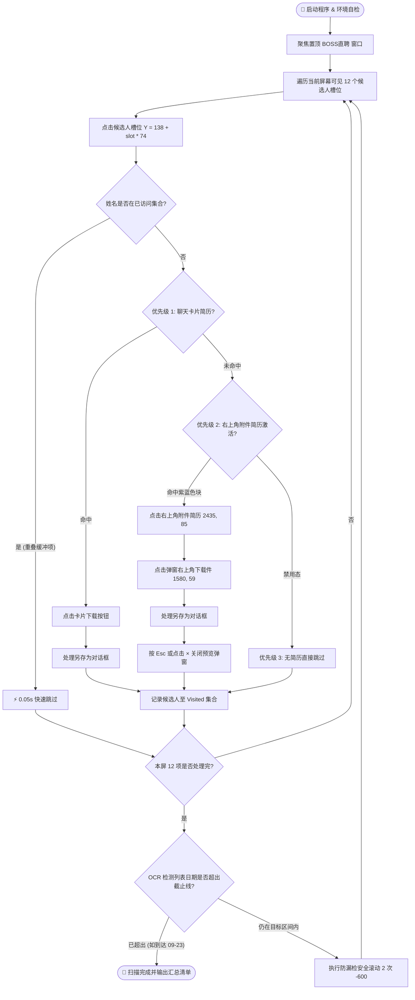

<div align="center">

# 🚀 BOSS直聘 招聘端 批量下载简历工具
### *Boss Zhi Ping Resume Downloader & Auto-Archiver*

基于计算机视觉（CV）与 Windows UI 自动化的高性能招聘端简历批量抓取归档引擎  
**支持三级下载优先级 · 防漏检重叠滑动算法 · 自定义日期范围 · 自动弹窗/另存为处理**

---

[](https://www.gnu.org/licenses/agpl-3.0)
[](https://www.python.org/)
[-orange.svg?style=flat-square&logo=windows)](https://microsoft.com)
[](https://opencv.org/)
[](https://github.com/JaidedAI/EasyOCR)
[](https://github.com/junallen649-maker/boss_Zhi_Ping/pulls)

</div>

---

## 🌟 核心特性与技术亮点

* 🎯 **三级优先级判定架构**
  * **优先级 1（聊天卡片）**：图像模板匹配聊天会话流中的简历附件卡片，一键直下；
  * **优先级 2（右上角【附件简历】弹窗）**：精准识别右上角激活紫蓝按钮（`RGB 115, 131, 255`），自动唤起预览大图，并准确定位弹窗右上角下载件图标 `[↓]`（坐标 `1580, 59`）进行下载并关闭弹窗；
  * **优先级 3（无附件跳过）**：若无附件卡片且按钮为浅灰禁用态（`RGB 245, 246, 255`），自动跳过。
* 🔄 **彻底解决跳人的“重叠滑动”算法 (Anti-Skipping Overlap)**
  * 深度实测证实 Windows 滚轮单次 `-600` 位移约 4.84 个候选人；
  * 摒弃传统大跨步盲目滚动，严格采用 **12 槽位采样 + 2 次 scroll(-600) (~9.7项位移)**；
  * 批次之间建立 **约 2.3 个候选人的重叠安全缓冲**，从几何数学上 **100% 杜绝跳过漏检任何候选人**。
* 🧠 **微秒级 OCR 姓名去重缓存**
  * 每次点击候选人即刻读取会话顶栏姓名并记录至 `visited_candidates` 缓存；
  * 重叠缓冲区的已处理候选人将在 **0.05 秒** 内瞬间静默跳过，兼顾零漏检与极高速度。
* ⏱️ **自定义扫描截止日期 (Cutoff Date)**
  * 支持自定义 `--cutoff-date`（如 `09-24` 或 `10-01`）；
  * EasyOCR 动态感知沟通列表中出现的日期信息，超出目标日期自动平稳停止。
* 📁 **Windows `#32770` 另存为窗口自动接管**
  * 自动激活保存窗口并发送确认；
  * 智能处理重名覆盖弹窗，自动为同名文件添加时间戳后缀，杜绝文件损坏或丢失。
* 🤖 **原生 Antigravity Agent Skill 支持**
  * 包含完整专属 Skill 结构（“有手有脚”的工具调用），支持 AI 编程助手或 Agent 无缝一键自主调度。

---

## 🔄 核心执行流程图



---

## 💻 快速开始

### 1. 环境依赖与安装

推荐使用 Python 3.10 或更高版本：

```bash
# 1. 克隆代码仓库
git clone https://github.com/junallen649-maker/boss_Zhi_Ping.git
cd boss_Zhi_Ping

# 2. 安装 Python 核心依赖库
pip install -r requirements.txt
```

> **运行环境要求**：
> * 操作系统：Windows 10 / 11
> * 屏幕分辨率：**2560 × 1440**（BOSS 直聘客户端窗口最大化）
> * 账号状态：BOSS直聘招聘端已正常登录并处于沟通界面

---

### 2. 执行环境诊断（推荐）

在正式执行下载前，运行诊断工具检查屏幕分辨率、窗口句柄及模板文件匹配度：

```bash
python diagnose.py
```

终端输出示例：
```text
=== [BOSS直聘 简历下载工具] 系统环境自检 ===
1. 屏幕分辨率: 2560x1440 (标准分辨率: 2560x1440) -> [正常]
2. 聊天卡片模板文件: resources/download_btn_crop.png -> [正常] 30x30 px
3. BOSS 直聘窗口检测: 找到窗口 HWND: 13306462 -> [正常]
4. 右上角【附件简历】按钮检测: 色块识别正常
5. 存储目录 D:\简历: 正常可写
=== 自检完成 ===
```

---

### 3. 一键启动自动批量下载

直接运行 `main.py` 或 `download_resumes.py`，支持指定截止日期与保存目录：

```bash
# 典型用法: 下载简历至 9月24日 (超出 9月24日 自动停止)，存至 D:\简历
python main.py --cutoff-date 09-24 --dest-dir D:\简历

# 自定义截止日期为 10月01日
python main.py --cutoff-date 10-01 --dest-dir D:\简历
```

---

### 4. 查看归档统计与报告

下载任务结束后，随时运行统计工具查看按岗位分类及文件大小清单：

```bash
python list_resumes.py --dir D:\简历
```

输出示例：
```text
=== [D:\简历] 简历存储归档统计 ===
总简历数: 46 份
分类分布:
  - 人事行政: 28 份
  - AI工程师: 11 份
  - 税务会计: 7 份

| 序号 | 简历文件名 | 大小 | 下载保存时间 |
| :--- | :--- | :--- | :--- |
| 1 | 【人事行政_广州 6-8K】石桂欣 6年.pdf | 644.1 KB | 2026-10-16 11:40:00 |
| 2 | 【AI工程师_广州 5-6K】赵曦 4年.pdf | 392.0 KB | 2026-10-16 09:30:45 |
...
```

---

## ⚙️ 命令行参数详表

| 参数名 | 简写 | 默认值 | 说明 |
| :--- | :--- | :--- | :--- |
| `--cutoff-date` | `-c` | `09-24` | 扫描截止日期。支持 `09-24`、`09月24日` 等格式，列表出现早于该日期的项时自动安全终止。 |
| `--dest-dir` | `-d` | `D:\简历` | 简历下载归档的目标本地目录（若不存在将自动创建）。 |
| `--max-batches` | `-m` | `60` | 最大翻页批次数限制，防止异常死循环。 |
| `--report-path` | `-r` | `None` | 自定义 Markdown 详细执行日志的生成保存路径。 |

---

## 🔬 技术内幕与防漏检数学模型

### 1. 滚轮跳跃问题与重叠数学证明
* **候选人卡片槽位规格**：单卡片高度为 **74px**；
* **Electron 滚轮特性**：Windows 下单次 `scroll(-600)` 触发 5 个 Detent，平移 **358px**（即 $358 / 74 = 4.84$ 个候选人）；
* **跳跃漏洞分析**：若每次翻页滚 5 次，位移量为 $5 \times 4.84 = 24.2$ 个候选人。若每屏仅扫描 14 个，则每次翻页必然**跳过越过 10 个候选人**！
* **重叠方案**：
  $$\text{单批扫描宽度} = 12 \text{ 项}$$
  $$\text{单次滚动位移} = 2 \times 4.84 \approx 9.7 \text{ 项}$$
  $$\text{重叠安全缓冲} = 12 - 9.7 = 2.3 \text{ 项}$$
  由于滚动位移严格小于视口宽度，**任意候选人必定至少出现在视口扫描区一次**，跳人率降至 0。

### 2. 关键元素坐标与 RGB 阈值 (2560x1440)
* **右上角【附件简历】按钮**：中心坐标 `(2435, 85)`；
  * 激活色块检测区间：`arr[70:95, 2390:2480]`；
  * 激活特征：`B > 200` 且 `R < 160` 且 `G < 160`（紫蓝色，像素数 > 200）；
  * 禁用特征：浅灰白色（RGB `245, 246, 255`，符合特征像素数为 0）。
* **预览大图弹窗下载件**：图标中心坐标 `(1580, 59)`，点击触发 Windows 标准另存为窗口。

---

## 🤖 Antigravity AI Agent Skill 集成

本项目不仅是命令行工具，还原生内置了 **Antigravity Customization Skill** 规范结构（位于 `.agents/skills/boss-resume-downloader/`）：

如果在使用 [Google Antigravity IDE](https://antigravity.google) 或兼容的 AI 智能体，Agent 将能够直接读取 [SKILL.md](file:///.agents/skills/boss-resume-downloader/SKILL.md) 并获得“有手有脚”的自主执行能力。你只需要在对话框中对 AI 说：
> *“请用 boss-resume-downloader 帮我把招聘端沟通列表里的简历下载到 10月01日”*

AI 将自动调用诊断脚本自检、启动下载进程、跟踪进度并交付汇总报表。

---

## 📂 项目结构

```text
boss_Zhi_Ping/
├── main.py                               # 项目启动主入口
├── download_resumes.py                   # 核心自动化调度执行脚本
├── diagnose.py                           # 系统分辨率与窗口环境自检工具
├── list_resumes.py                       # 简历归档查询与分类报表工具
├── requirements.txt                      # Python 依赖清单
├── LICENSE                               # AGPLv3 开源授权协议
├── README.md                             # 项目详尽中文使用说明文档
├── resources/
│   └── download_btn_crop.png             # 聊天卡片下载图标模板
├── docs/
│   └── workflow_guide.md                 # 界面坐标与防跳算法技术手册
└── .agents/
    └── skills/
        └── boss-resume-downloader/       # 原生 Antigravity AI Agent 技能包
            ├── SKILL.md
            ├── scripts/
            ├── resources/
            └── references/
```

---

## 📄 开源许可证 (License)

本项目采用 **[GNU Affero General Public License v3.0 (AGPLv3)](LICENSE)** 强互惠开源许可证授权。

* **自由使用与修改**：欢迎任何人自由运行、学习和修改代码；
* **强传染保护**：任何人基于本项目修改、衍生或套壳开发软件（包括通过网络提供 Web/SaaS 服务），**必须无条件以相同开源许可证完全公开所有衍生源代码**；
* **禁止闭源商业买卖**：严禁未经开源闭源打包作为专有商业软件销售。
